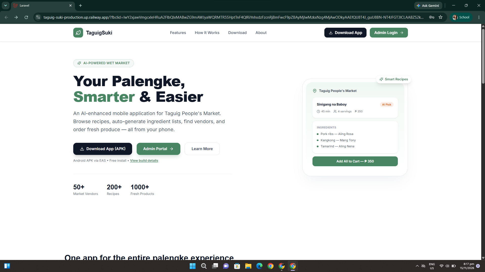
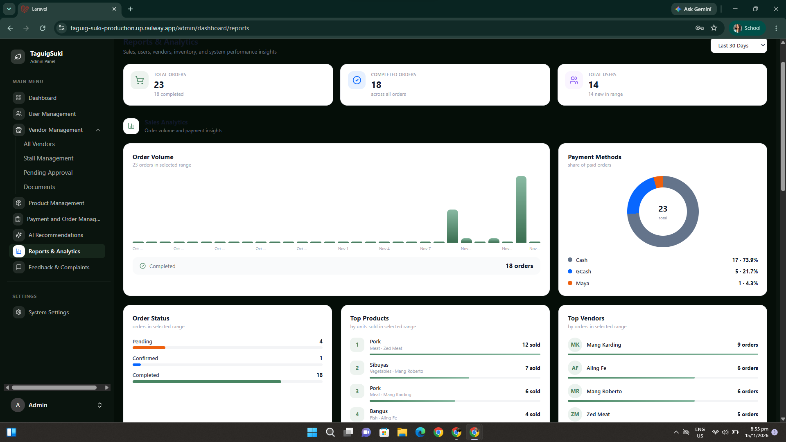
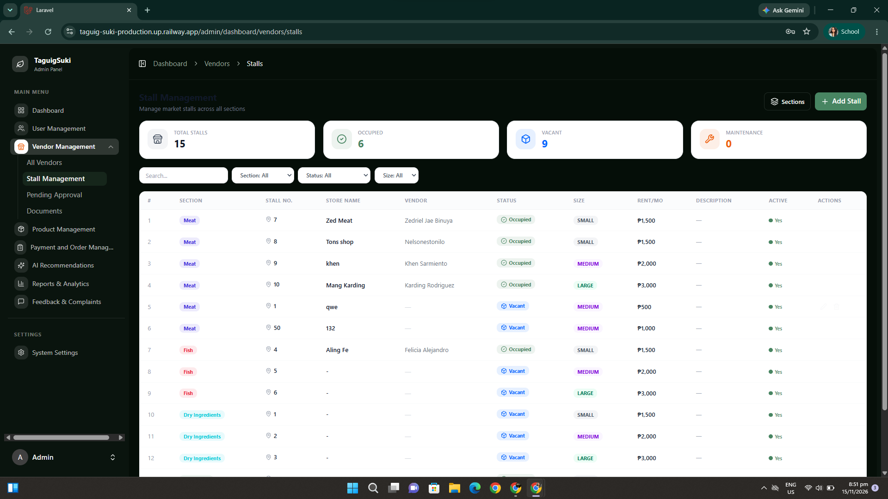
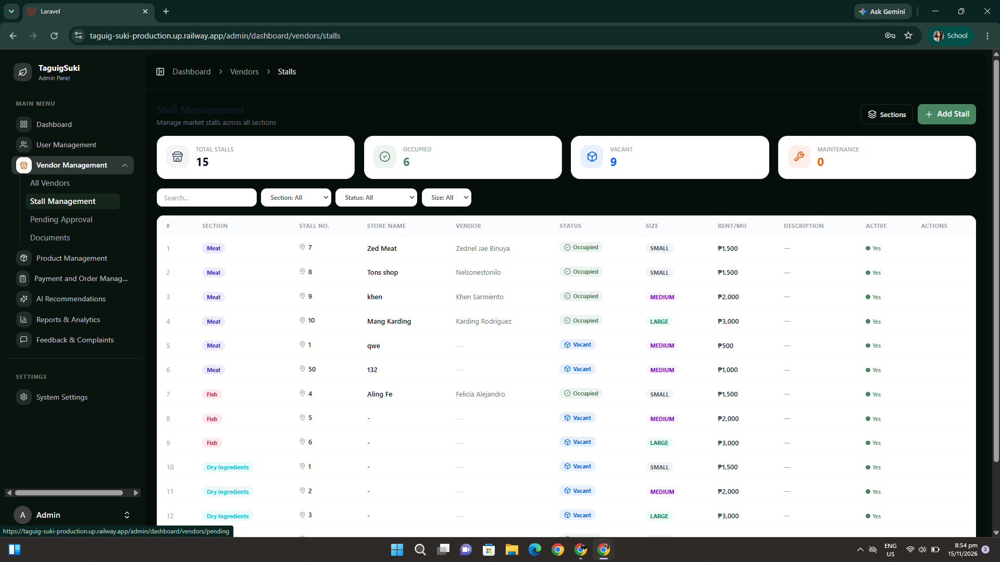
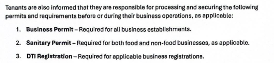

# Suggestions for Revision

1. **APK Download** – Need a specific name in the download app (APK) so users know what they are downloading.

   
   *Landing page with the Download App (APK) button.*

2. **Sales and Revenue Report** – Provide a daily sales and revenue report that can be generated as PDF or printed, on both the admin and vendor sides.

3. **Product Report** – Clarify the purpose of the Product Report on the admin side and what product information should be shown and monitored.

   
   *Admin Reports & Analytics dashboard showing sales, top products, and top vendors.*

4. **Stall and Vendor Management** – Should be able to add and edit stalls, view the stall number, category, assigned vendor, and whether the stall is available or occupied. Available stalls for rent should be limited to the actual number of stalls in the market, and the store numbering should be selectable from a dropdown instead of being typed manually. **AYUSIN PA PO NAMIN**

   
   *Admin Stall Management page listing stalls, sections, vendors, status, size, and rent/month.*

5. **Stall Selector** – Provide stall monitoring where the admin can see customer complaints about stalls, such as bad smell, cleanliness, and other concerns. It should also show whether the reports have been complied with or resolved.

6. **AI Product Recommendation** – When a customer searches for a product, for example pork, the system should show all stalls or vendors selling the same product, including their prices, product availability, and vendor ratings. An AI-based recommendation will prioritize the vendor with the highest rating while keeping other vendors selling the same product visible. When the customer selects or taps a product such as pork, it should have a dropdown menu showing the list of all vendors selling it. The list is automatically sorted from the highest-rated vendor down to the others. This way, customers can easily compare the price, availability, and ratings of each vendor to choose a product that fits their preference and budget.

7. **Vendor Verification and Contract** – Add contract duration, start and end dates, and expiration notifications for both admin and vendor. There should be an option for the vendor to renew.

8. **Monthly Stall Rental Payment** – Provide rental payment monitoring showing who is paid, unpaid, pending, and overdue. Also include payment due dates and automatic notifications.

   
   *Stall Management view showing the rent per month for each stall.*

9. **Customer Receipt** – Provide a complete transaction receipt showing the products, prices, quantity, total amount, vendor/stall, and transaction details.

10. **Checkout UI** – Improve the checkout interface so it is easier to use and understand for customers.

11. **Rental Reports** – Provide rental reports showing vendor rental records, payments, and requirements.

12. **Payment** – On a customer's first order with a vendor, GCash and PayMaya work fine, but when the customer orders again, GCash and PayMaya no longer work and just keep loading when tapped.

    
    *Checkout showing "Loading vendor payment details..." — the loading issue reported above.*

13. **Ratings** – Currently a product or vendor can only be rated once. It would be better if the vendor and product could be rated per order so they have a basis for their rating on each order.

14. **Required Documents for Vendors** – The vendor's required documents are a valid ID, business permit, sanitary permit, and DTI registration.

    
    *Permits and requirements: Business Permit, Sanitary Permit, DTI Registration.*

15. **AI Recommendation** – Use the actual Google Gemini AI for the AI assistant and recommendations. Recommendations should be based on the actual database of products, prices, availability, and stall information.

16. **Product Deletion Reason and Vendor Notification (Admin and Vendor Interface)** – Require administrators to provide a specific reason whenever deleting a vendor's product. The deletion reason is recorded in system audit logs and automatically sent as an in-app notification to the affected vendor. Vendors can view this notification, its full explanation, and access an audit history of administrative removals to ensure transparency and accountability.

17. **Stall Occupancy Filtering in Reports (Admin Interface)** – Modify the report generation process so that only occupied stalls are included in sales and stall reports. Unoccupied stalls (vacant, under maintenance, or unassigned) are excluded to ensure accurate, relevant reporting on stalls actively being used by vendors.

18. **Monthly Stall Rental Payments (Individual / Collective Billing and Vendor Notification)** – Provide administrators the option to generate monthly stall rental bills individually for a selected vendor or collectively for all occupied stalls. Whenever a rental bill is generated, the affected vendor automatically receives an in-app notification informing them of their outstanding stall rental balance, billing period, and payment due date.

19. **Stall Rental Payment Status Management (Admin Interface)** – Add an option for administrators to edit or update the payment status of each vendor's rental bill (such as **Paid**, **Unpaid**, **Pending Verification**, or **Overdue**). When a vendor settles their rental payment, administrators can record the settlement details (payment method, date, receipt reference, notes) and update the status, which updates the market records and automatically notifies the vendor.

20. **Vendor Rental Reports – Contract Renewal and Cancellation Requests** – An automatic notification system alerts vendors when their stall rental contracts are approaching their expiration dates (e.g., within 30 days), giving them sufficient time to decide whether to continue renting their stalls. Through this notification or directly via their Profile/Dashboard, vendors can initiate a request by choosing either **Contract Renewal** (with duration options of 1 month, 3 months, 6 months, or 1 year) or **Contract Cancellation** (with optional explanation). Contracts are not automatically renewed or cancelled upon submission; all requests are queued as pending. Administrators can review all submitted requests and relevant contract details under Vendor Rental Reports (`/admin/dashboard/vendors/rentals/reports`), approving or rejecting them with custom durations or administrative notes. Upon administrative resolution, the vendor automatically receives a notification indicating whether the request was approved or rejected along with updated contract dates and status. When a previous contract has been cancelled and approved, any new contract computation strictly excludes remaining months from the cancelled contract, calculating expiration based solely on the new start date and duration. In addition, the Contract Term field is removed from the vendor interface, cleanly displaying only the **Lease Start Date** and **Expiration Date**.

21. **Feedback and Complaints – Response Functionality** – Remove the required response option for customer ratings without comments (star-only ratings). Ratings submitted without written text are automatically acknowledged and marked as resolved (`needs_response = false`), ensuring they do not clutter pending response queues. Vendors and administrators are only prompted and permitted to respond to actual customer complaints or written feedback needing attention. Through the Vendor Interface (`/reviews`), vendors can filter customer concerns, submit official store responses, and immediately resolve issues. Customer review cards prominently display the store's response, and an in-app notification is automatically dispatched to the customer informing them of the vendor's resolution. On the Admin Web Portal (`/admin/dashboard/feedback`), rating-only submissions are flagged with clear "No comment · No response needed" indicators and the Respond action is disabled, focusing administrative metrics strictly on actionable complaints.

22. **Vendor Stall Lease & Contract Expiration Computation** – Exclude remaining months of previously cancelled contracts from new contract expiration calculations. When a contract is cancelled and approved by the admin, any subsequent contract start date and duration must strictly determine the new expiration date without carryover. Furthermore, the redundant "Term" field has been removed from the vendor profile interface to prevent confusion, displaying only the **Lease Start Date** and **Expiration Date**.

23. **Product Ratings Synchronization in Customer Featured Products** – Resolve the static 4.5 star display in the Featured Products section so it dynamically reflects actual customer review ratings. Products with customer reviews now compute the true average rating and display the review count badge (e.g. `★ 5.0 (2)`), matching the Product Details modal. Fresh products without reviews cleanly display a 5.0 baseline or the vendor's store rating, updating in real-time on screen focus.

24. **Admin AI Recommendations Navigation Removal** – Hide and remove the AI Recommendations feature from the admin interface (`/admin/dashboard/recommendations`) and sidebar menu per administrative workflow specifications. Any direct URL access automatically redirects to the admin dashboard, keeping customer-side AI recipe suggestions fully functional while simplifying admin operations.

25. **Customer Product Detail Modal Report Stall Functionality** – Provide prominent, easily accessible Report Stall action points on the customer mobile product view. Includes an amber flag icon button on the top image header overlay beside the favorites button, an inline report badge on the stall card, and a dedicated full-width complaint action card that opens the `StallComplaintModal` with reliable fallback data for administrative complaint processing.
