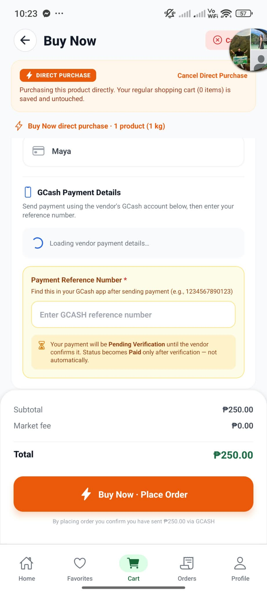

# Suggestions for Revision

1. **APK Download** – Need a specific name in the download app (APK) so users know what they are downloading.

   
   *Landing page with the Download App (APK) button.*

2. **Sales and Revenue Report** – Provide a daily sales and revenue report that can be generated as PDF or printed, on both the admin and vendor sides.

3. **Product Report** – Clarify the purpose of the Product Report on the admin side and what product information should be shown and monitored.

   
   *Admin Reports & Analytics dashboard showing sales, top products, and top vendors.*

4. **Stall and Vendor Management** – Should be able to add and edit stalls, view the stall number, category, assigned vendor, and whether the stall is available or occupied. Available stalls for rent should be limited to the actual number of stalls in the market, and the store numbering should be selectable from a dropdown instead of being typed manually. **AYUSIN PA PO NAMIN**

   
   *Admin Stall Management page listing stalls, sections, vendors, status, size, and rent/month.*

5. **Stall Selector** – Provide stall monitoring where the admin can see customer complaints about stalls, such as bad smell, cleanliness, and other concerns. It should also show whether the reports have been complied with or resolved.

6. **AI Product Recommendation** – When a customer searches for a product, for example pork, the system should show all stalls or vendors selling the same product, including their prices, product availability, and vendor ratings. An AI-based recommendation will prioritize the vendor with the highest rating while keeping other vendors selling the same product visible. When the customer selects or taps a product such as pork, it should have a dropdown menu showing the list of all vendors selling it. The list is automatically sorted from the highest-rated vendor down to the others. This way, customers can easily compare the price, availability, and ratings of each vendor to choose a product that fits their preference and budget.

7. **Vendor Verification and Contract** – Add contract duration, start and end dates, and expiration notifications for both admin and vendor. There should be an option for the vendor to renew.

8. **Monthly Stall Rental Payment** – Provide rental payment monitoring showing who is paid, unpaid, pending, and overdue. Also include payment due dates and automatic notifications.

   
   *Stall Management view showing the rent per month for each stall.*

9. **Customer Receipt** – Provide a complete transaction receipt showing the products, prices, quantity, total amount, vendor/stall, and transaction details.

10. **Checkout UI** – Improve the checkout interface so it is easier to use and understand for customers.

11. **Rental Reports** – Provide rental reports showing vendor rental records, payments, and requirements.

12. **Payment** – On a customer's first order with a vendor, GCash and PayMaya work fine, but when the customer orders again, GCash and PayMaya no longer work and just keep loading when tapped.

    
    *Checkout showing "Loading vendor payment details..." — the loading issue reported above.*

13. **Ratings** – Currently a product or vendor can only be rated once. It would be better if the vendor and product could be rated per order so they have a basis for their rating on each order.

14. **Required Documents for Vendors** – The vendor's required documents are a valid ID, business permit, sanitary permit, and DTI registration.

    
    *Permits and requirements: Business Permit, Sanitary Permit, DTI Registration.*

15. **AI Recommendation** – Use the actual Google Gemini AI for the AI assistant and recommendations. Recommendations should be based on the actual database of products, prices, availability, and stall information.
