# System Revision

## 1. Auto Compute Rent per Month

- On the admin side, the rent should be set to an automatic amount so no amount needs to be edited; whichever size is clicked, that exact amount is what will be displayed.

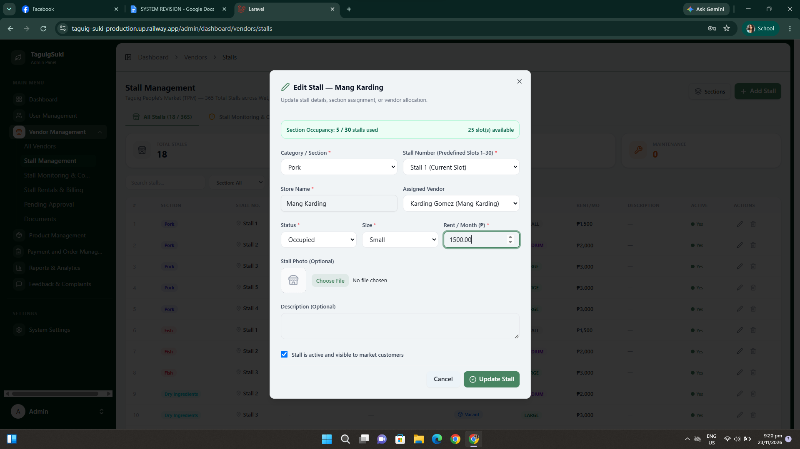

## 2. Separate Fields

- The related features, Stall Monitoring & Sanitation Complaints and Stall Rentals & Billing, should be placed inside Stall Management. Instead of being listed separately in the Admin Main Menu, they will become submenus or sections under Stall Management. In short, when the admin clicks Stall Management, that is where they will see and access Stall Monitoring & Sanitation Complaints and Stall Rentals & Billing.

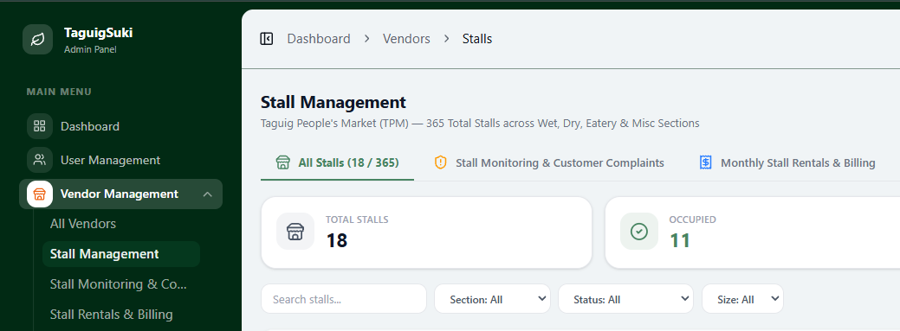

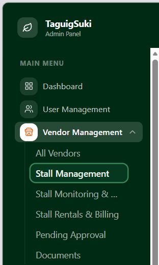

## 3. PDF and Image Uploading

- During account registration for both Vendor and Customer, there should be an option to upload supporting documents in either PDF or image format.

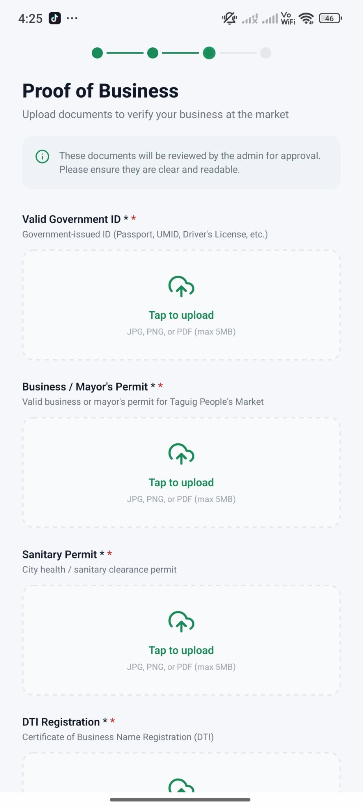

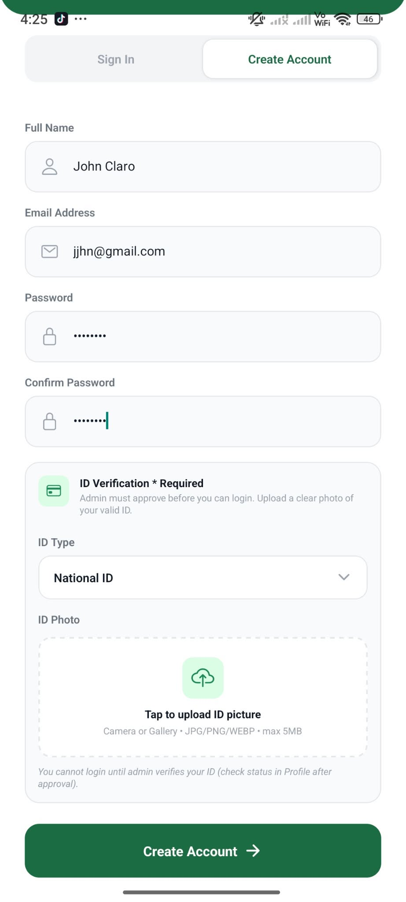

## 4. Notification on Account Approval

- There should be notifications on the admin side when a customer or vendor requests account approval.
- Once the admin approves the account created by the customer or vendor, a notification should be sent to the email they used.

## 5. Remove Redundant Fields

- One of them should be removed because they are almost the same.

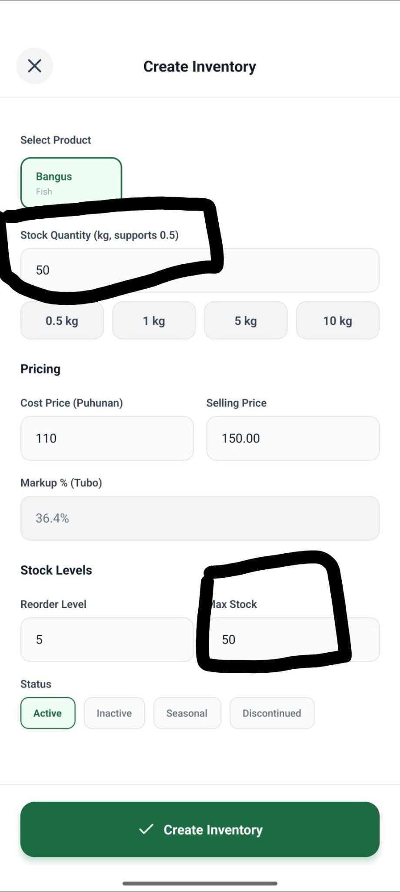

- Remove "Mark as Paid" and keep only "Update Status" because they are the same.

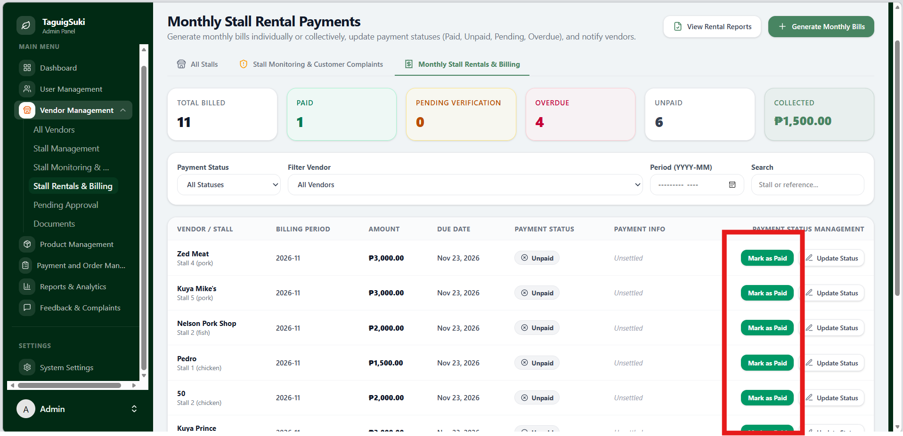

## 6. Process of Canceling Orders

- On the customer side, there should be a Cancel Order option so the customer can cancel an order, but with a specific condition on when it can be used. When the vendor has not yet confirmed the order, the customer is still allowed to cancel. However, once the vendor confirms the order, canceling should no longer be allowed or the Cancel Order button should be disabled, and the customer can no longer cancel the order.

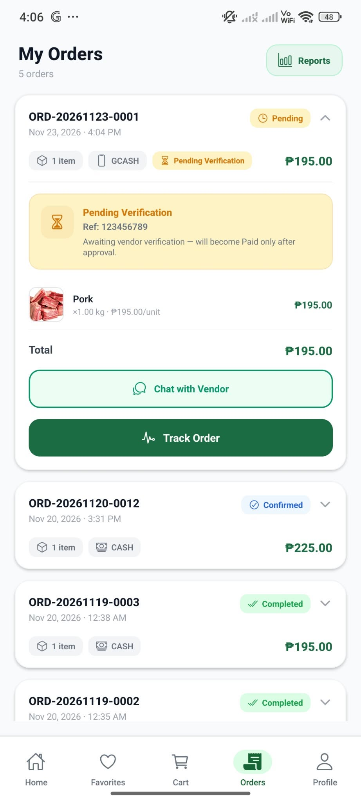

- On the vendor side, there should also be a Cancel Order option so the vendor has control over orders that are not picked up promptly by the customer. For example, if the vendor has confirmed the order and it has become Ready for Pickup, but 1 hour has passed and the customer still has not picked it up, the vendor should have the option to cancel the order. Alternatively, there should be a one-hour countdown for both the customer and the vendor if that is the better option, similar to other apps where, if the customer does not confirm and one hour passes, the order automatically cancels for both the customer and the vendor.

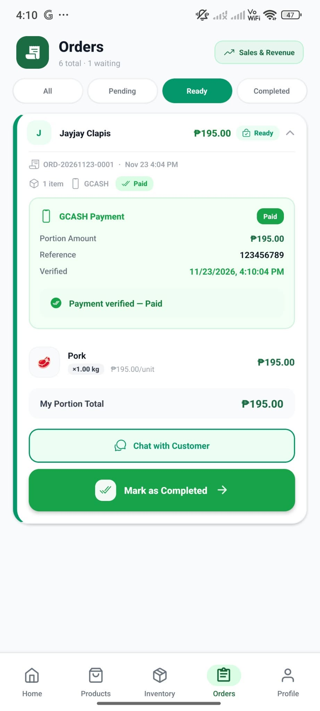

## 7. Remaining Stocks of Products

- The vendor's stock should not be deducted immediately when a customer places an order. The stock should only be deducted once the order status is marked as Completed, meaning the customer has successfully picked up the order. For example, if someone places an order and then suddenly cancels it, the vendor's stock should not be deducted because the transaction did not push through.
- The remaining available stock for each product should also be visible on the customer side so the customer is aware of how much stock is left before placing an order. For example, if there are 15 stocks available, the customer should see "15 stocks available" in the product details or product listing.

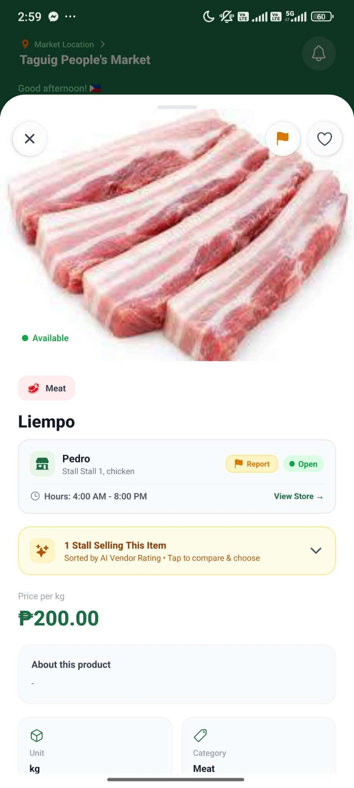

## 8. Organize Process of Confirmation

- For COD (Cash on Delivery), the Confirm Order button on the customer side should be removed. Once the customer clicks Buy Now on a product, the order will automatically be created and immediately appear on the vendor side for the vendor to see and process. The customer no longer needs to confirm again because clicking Buy Now is already considered confirmation of ordering the product.

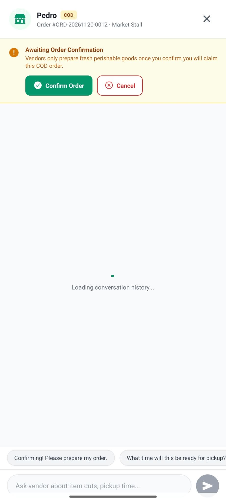

## 9. Products That Are Out of Stock

- The customer should immediately see that a product is "Out of Stock" right on the product picture, not only when they reach the payment page. Currently, the customer can still add to cart and proceed all the way to payment even when there is no available stock, and they only find out on the payment page that the product is out of stock.

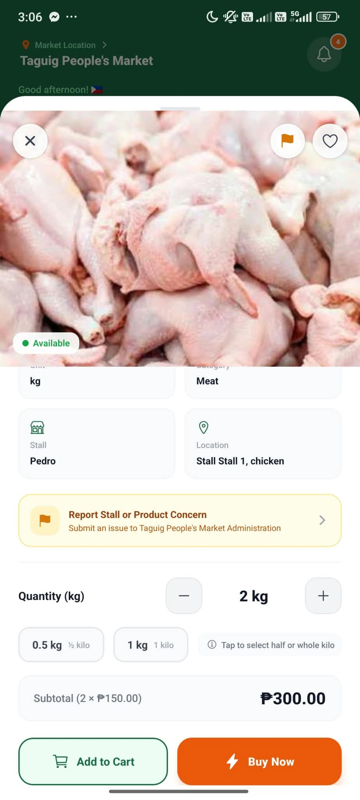

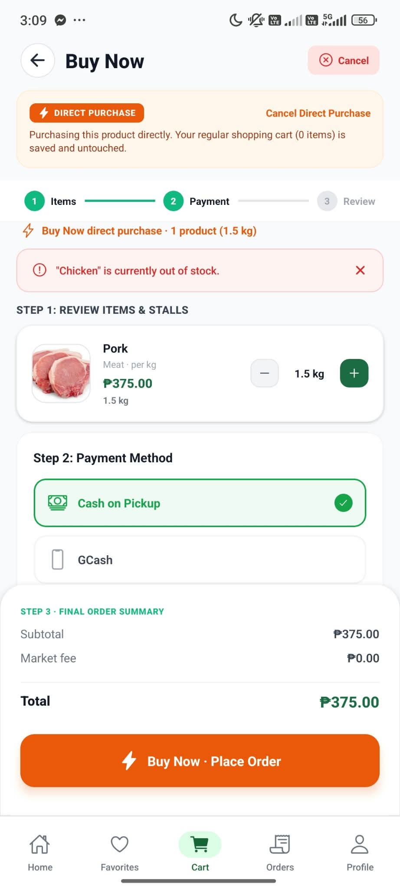

## 10. Quantity Field

- When the customer places an order, they can still order a quantity greater than the set Reorder Level. For example, if the Reorder Level is 5, the customer should only be allowed to order up to 5 units. However, currently, even if they order more than 5 units, the system still accepts it.

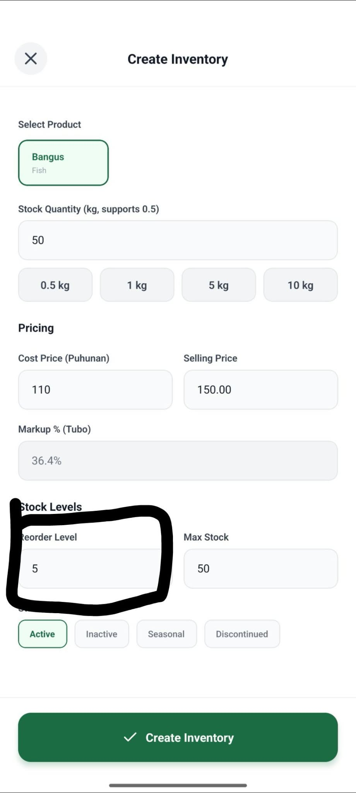

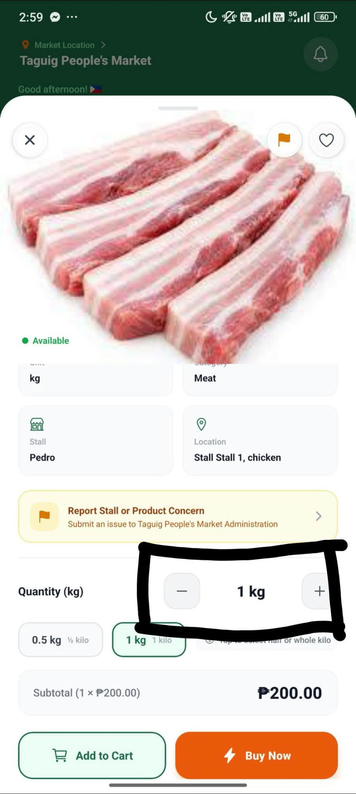

- The plus (+) and minus (-) buttons for setting the order quantity should be removed. Instead, provide an input field where the customer can directly type the quantity they want to order. This is more convenient, especially when the customer is ordering a large amount, because they no longer have to repeatedly press the plus (+) button to reach their desired quantity.

